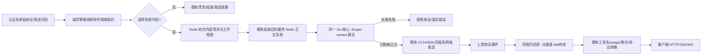

# vm2api 可启停脱敏插件设计

状态：**设计交付，未实施；不代表已批准实施。** 日期：2026-10-28。

## 1. 结论与范围

采用 **vm2api 内置能力 + Node 清洗阶段插件 + 本机 Go 算法进程 + Web 控制面板**。Node 负责在既有请求清洗中触发/跳过关键元素脱敏；Go 仅作为受控本机算法实现，不是另一台网关或外部部署目标。不创建通用插件市场，不搬入 AgentDock 整个插件运行时，不用 JS 重写识别规则，不引入云端脱敏调用。

用户可通过现有管理设置开启/关闭。默认关闭；关闭时保持原有推理流程，开启时对支持路径中可处理的文本执行本地稳定假名化，回复中可恢复的标签在返回调用方前还原。**开启但处理不可用时拒绝请求，不回落明文。**

保护承诺限定为：经过所列 vm2api 路径、协议适配器实际检查的明文字符串与配置检测器命中的值。它不是任意载荷 DLP：认证/路由元数据、协议 ID、schema 结构、URL/图片/音频/二进制、opaque 加密推理等有明确边界；不保证未知敏感信息全部被识别。宿主产生的最终 HTTP 指纹/元数据不是该功能的保护目标。

本轮交付 PRD、技术设计、实施计划、证据和真实合成核心 smoke；**没有可安装的新插件、修改后的 vm2api 或部署产物**。

### 1.1 关键元素范围

| 选项 | Node 可处理正文中的目标 | 不作隐式扩大 |
| --- | --- | --- |
| secrets | API key、token/JWT、私钥、连接串密码、配置赋值里的秘密 | 实际用于上游鉴权的 HTTP 头不替换；提示词里粘贴的凭据按文本处理 |
| personal | 真实邮箱、电话、身份证件/卡号等原核心支持类别 | 不把所有数字、日期或协议 ID 一律视为个人信息 |
| words | 项目代号、姓名、主机名、仓库/目录名等用户显式配置的词 | 本机路径、IP、MAC 不自动全遮；需要时显式配置，避免破坏代码/链接 |
| rules | 用户显式配置的前缀或 RE2 模式，沿用原核心校验与捕获组行为 | 不允许任意 JS 脚本、不使用临时字符串替换绕过边界 |

主处理对象是消息正文、system/instructions、工具结果、工具实际参数和定义描述。协议字段名并非判定数据的充分依据：工具参数内的 name/user_id/signature 可以是业务数据；真正的签名、调用 ID、schema/grammar、编码附件必须保留。

### 1.2 Node 清洗阶段的两道边界

1. 保留原始入站视图，只用于认证后的客户端/用途识别、调度身份与协议校验；不将原始对象当成已清洗的发送正文。
2. 保持当前 `sanitizeInboundBody` 的同步职责：删除客户端设置和机器指纹。它位于 `seed-policy.mjs:187-216`，由 `handle-protocol.mjs:699` 调用，**目前不是内容脱敏器**；不把整个异步 helper 调用强塞入这个同步函数。
3. 新增共享、可 await 的 Node 内容清洗阶段（建议命名 `sanitizeSensitiveContent`）：在目标协议内容归一化、classifier 用途识别之后，由请求 Lease 按 enabled 快照调用 Go 核心。处理后的工作视图供 personaIn、canonicalBody 等后续正文组装使用；原始识别视图不被覆盖。
4. 在每条路径最后的 Node 正文出口再调用同一内容清洗器，幂等处理 persona/修复/协议转换后新增或重引入的文字，然后才做 CCH/长度/压缩和发送。不是两套规则；首次清洗减少原值传播，末次复核防止旧 raw 对象重新泄漏。
5. 关闭时仅跳过新增的可逆内容脱敏，不跳过既有协议、身份、签名、缓存及日志清洗。回复仍由对应 on 请求的 Lease 恢复，不能使用“此刻全局开关”决定是否恢复旧流。

Codex/API/search/images 的分支仍需各自接共享清洗器，因为它们并非全都经过 Claude 的 toClaudeMessages。Web 面板改变的是同一 Node 策略快照，不是 kernel/CLI 的另一套开关。

## 2. 为什么不能直接复制参考插件

参考核心的规则/区间融合、RE2 校验、JSON 参数转义可复用；但其 `Options` 无独立 Enabled，插件按 Wanted 自动保活。原值、key、known、sentKnown、shape 是全局状态，标签只有 40-bit，普通标签未消歧。原 Writer 是单 pending SSE 状态机，压缩响应透传、整体响应无本层缓冲上限。

上述是源码事实，不是泛化的安全断言。具体出处见 [evidence.md](evidence.md)。本轮 smoke 已验证基本可逆性，也观察到全局 Restore 不接受租户参数；不能原样包装成多用户 RPC 服务。

## 3. 配置和总开关

### 3.1 唯一权威

扩展既有 `routing.json` 的顶层 `redaction`，管理入口仍是 `GET/PUT /api/panel/routing`，旧 `/admin/routing`、启动加载、外部 reload、备份恢复共用同一归一化/校验与发布逻辑。**不在 `compatibility`、VM JSON、kernel.json 或环境变量再设一个覆盖开关。** 不支持调用方请求头/body、单 VM 或单 provider 绕过。

建议配置（新字段，尚不存在）：

```json
{
  "redaction": {
    "enabled": false,
    "secrets": true,
    "personal": true,
    "words": [],
    "rules": []
  }
}
```

- `enabled` 缺失只在旧配置迁移时视为 false；显式值必须是 boolean。`null`、字符串 `"false"`、未知字段或坏结构拒绝，不通过真值转换。
- `secrets/personal` 是独立选择；自定义规则沿用原核心“随 secrets 生效”的语义。words/rules 关闭时保留，不清空、不改写为无效占位。
- enabled=true 且 secrets/personal 均 false、无有效 words 时拒绝，不能显示开启而无任何有效保护。
- rules 复用 `CheckRules` 的 RE2/前缀/捕获组和数量限制；保存前编译。words 建议上限 256 条、单条 1 KiB、合计 64 KiB，去空白空项/精确重复项，不把保存输入静默截断。
- 不开放参考 Actions/Allow、warn 放行、Shape 或模型选项。它们不是当前“可启停脱敏”的必要机制；模型执行与下载不在本设计范围，避免开启后仍存在隐式云调用或规则降级。

### 3.2 启停和并发

| 条件/操作 | 新请求 | 已接受的请求及其重试 | 映射/配置 |
| --- | --- | --- | --- |
| 默认/已关闭 | 不调用可逆插件，不改正文、不接还原器 | 按该请求既有快照完成 | 保留检测配置；无请求时不需保持 helper 进程 |
| 从关闭开启 | 验证配置、key、helper 版本/能力成功后，先落盘再发布快照 | 已接受的 off 请求仍 off，包括排队请求 | 发布新的策略 revision；不重启 kernel/CLI |
| 开启失败 | 保存返回 503；旧配置/策略不变 | 不受失败候选策略影响 | 不出现“保存成功但实际绕过” |
| 已开启运行故障 | 返回 503 redaction_unavailable；零新上游执行 | 无法恢复的流终止为真实错误，不伪造完成 | 不改为 disabled，不换号重试插件故障 |
| 从开启关闭 | 保存成功后进入的新请求旁路 | 原 on 请求继续脱敏、还原和收尾，不中断长流 | 不能删除其租约/映射；最后引用释放后才可停进程 |
| Node/helper 重启而磁盘仍开启 | helper/key 准备完成前拒绝推理 | 旧进程流遵守正常排空；崩溃流真实失败 | 不持久化原值表；不能解密恢复失去的原值 |

快照在认证与必要协议识别之后、建立可外发副作用之前创建，一次请求固定一次。面板文案必须说明“仅影响保存后新进入的请求；排队和执行中的请求保留旧策略”。不能承诺开启响应返回后所有旧 off 队列都已停止外发。

配置变更串行化：校验完整候选 → 准备未发布策略/运行资源 → 使用既有原子写工具持久化完整候选 → 发布不可变快照。失败回到旧快照。当前 `persistRoutingPatch` 是共享对象就地修改＋直接写文件，不是该原子契约的现成证明；实施时须调整此保存边界，其他字段合并语义不变。外部更新只有经过同样校验才可发布；损坏更新保持最后有效策略并报错，首次加载无有效策略则启动失败。

## 4. 架构和所有权



### 4.1 部署形式

建议新增 `kin-redact`，由控制面 Node 管理，使用仅本机 Unix domain socket，目录 0700、socket 0600；不监听 TCP、不进槽内、不依赖 Go fallback worker 是否启用。复用现有 Unix HTTP 客户端/子进程生命周期模式，不做 HTTP MITM、不改变槽位代理或供应商出口。

Go 核心迁入自身模块合法的 internal 包，保留 MIT 和来源快照身份；只引入实际需要的 publicsuffix 依赖，不复制 AgentDock settings/pluginrt/gui/pii。交付构建与 payload 安装也必须包含 helper，不能只部署 Node 就允许开启。

### 4.2 内部契约（建议，非现有 API）

- `beginRequest(policySnapshot, authenticatedPrincipal, explicitConversation?) → Lease`：Node 从可信身份派生作用域；返回不可猜测 lease handle。传给 helper 的身份不能来自未认证 body 自报。
- `mask(lease, attempt, protocol, bodyBytes) → maskedBytes + aggregateHits`：原始 JSON 字节传输，不将大 body 再 base64/JSON-string 双重封装；返回不含原值/hint 的计数。每个实际发送尝试都经过此门，重复调用幂等。
- `restoreStream(lease, attempt, protocol, source) → sourceProtocolEvents`：helper 对一个响应建立独立、有背压的流通道；输入是解压后的原协议 JSON/SSE，输出仍是同协议。Unix HTTP 双向流承担传输，不逐 token 新建请求，不额外收集第二份完整 SSE。
- `restoreBody(...)`：非流/完整快照使用同一标签解析器和授权集合；不能 delta 和 done 各有不同规则。
- `finish/release(lease, attempt, terminal)`：success/error/cancel/EOF 均恰好收尾一次，释放 active 引用。它不是让截断流变成 completed 的指令。
- helper `/health` 报告协议版本、tag-format、scope/多通道恢复能力；不回传映射。Node 检查能力后才允许开启。内部调用有进程随机 capability，用户接口不暴露 handle、原值或 key。

Node 固定策略并控制是否发送，Go 持有算法状态/敏感映射；原值不复制到 Rust/CLI envelope。请求与响应只在本机可信进程间处理。helper 不调用供应商、不持有供应商凭据，不参与调度/计费/换号。

## 5. 作用域、标签和生命周期

### 5.1 作用域不是 sticky 路由键

- 安全隔离基线按经过认证的 managed API key **内部 ID** 分域；master 使用部署内固定独立域。即使两个 key 属于同一用户，也不默认共享原值表。
- 域内使用明确会话标识；无可信/明确会话则使用请求域，不借助“首条用户文本相同”、VM、outbound session S 或账号来建立授权关系。跨协议只有认证域和明确会话都相同才共享映射。
- 输入的会话 ID 只是同一认证域内的名称，不是权限。不能靠知道 tag 或复制另一请求 ID 获得还原权。
- Scope 对象持有 values/known/kinds/sentKnown 等状态；源码只读规则可共享，所有与原值/命中历史相关的缓存必须实例化。策略候选缓存纳入完整策略 revision；同 Scope 的更新串行，不能并发 miss 改写首次决定。

### 5.2 标签

建议新格式 `{{R_KIND_<26位小写Base32>}}`，后缀由 HMAC-SHA256 的前 16 bytes 编码，实际 128 bits。输入按长度分隔编码部署域、认证域、明确会话、kind 和原值；不拼接歧义字符串，不含 VM/attempt。

部署根 key 32 bytes，安全创建/读取，权限 0600；随机数、读取、写入错误必须显式失败，不能照搬原实现忽略错误。key 可以持久化，原值表不持久化；**标签不是可解密密文**。

登记时总要核对同 token 的原值是否一致；不同则报 redaction_collision 并阻断，绝不选第一个值。新 parser、tail 检测、JSON/SSE 恢复必须使用同一格式约束，不只改生成器。这里没有旧插件数据需兼容，不添加 8 字符旧标签的跨域兼容查询。

- 仅保护本 Scope 确认生成的标签；不能因某段文本长得像 `{{...}}` 就跳过内部敏感值检测。
- 每个 Lease 的还原授权集合只含本次从原值构建的绑定及已验证 continuation 的绑定；仅在输入中出现一个标签不扩大授权。外域或不在集合内的标签保持字面值，不查询全局表。
- 精确还原完整标签；不启用缺括号、大小写猜测式恢复，以降低错误替换。中文、反斜线和嵌套 JSON 由协议适配器保证边界/转义。

### 5.3 有界资源（建议初始值，未做性能证明）

| 资源 | 建议边界 | 达限行为 |
| --- | --- | --- |
| 活跃响应租约 | 每 Node 最多 256，受原有并发限制再次约束 | 新请求 503 redaction_capacity；不抢占在途 |
| 空闲 Scope | 最多 4096，空闲 1h 可回收 | 仅淘汰无 active 引用对象 |
| 原值映射 | 每 Scope 4096 项/8 MiB，全局敏感状态预算 256 MiB | 发送前完整预检；不足则不发送，不能半遮半发 |
| known/策略缓存 | 共计纳入上述字节预算，无跨 Scope 共享 | 丢计算缓存可重算；不丢活跃恢复绑定 |
| 单事件/未分帧响应 | 8 MiB | 真实流错误并取消当前 hop，不无限缓冲 |
| 未闭合标签尾部 | 单通道 128 bytes，单响应最多 1024 个通道 | 明确协议错误，不跨通道拼接 |
| 请求 body | 沿用 inboundBodyLimit，脱敏扩张后再查最终发送预算 | 413 redaction_body_too_large，零发送 |

处理并发和队列必须有界，取消传递到正在等待的 mask/restore 操作。只有 mask 成功才允许注册“可发送”结果；不得为了缓存稳定保留旧的明文决定。策略变更允许 cache 冷写，安全优先于“首次发送永不变化”的优化。

重启/淘汰后有完整原文的历史可以重新登记确定性标签；只有历史标签没有原文时无法找回原值。界面和 API 文档必须说明这一点，不能承诺无限历史恢复。

## 6. 实际挂点和覆盖矩阵

下表是**实施要求**，不是已支持状态。输入四种主协议 Messages/Chat/Completions/Responses 的正文统一经各自既有转换路径，不另写第二套协议规范化。

| 路径 | 发送前挂点与当前源码 | 响应还原挂点 |
| --- | --- | --- |
| Claude native、classifier | `handle-protocol.mjs:1359-1593` 的每 attempt 重渲染之后；`go-worker-client.mjs:408-482,724-744` 两种普通/显式 envelope 汇合后的发送门 | 原 Anthropic 事件进入工具名还原、usage 隐藏、converter/assembler 之前；覆盖非流和流 |
| Claude Rust HTTP hop | 同一发送门；正文必须在 Node CCH 密封之前完成 | 同上，不在 res.write 层裸替换 |
| API backend Anthropic/Responses upstream | `api-protocol.mjs:207-290,351-676` endpoint 协议/模型转换后、`forwardApi` 前；不能只改 Claude canonicalBody | 原上游协议解析后、API 协议转换/聚合前 |
| Codex HTTP / upstream WS | `handle-codex.mjs:760-949` 构造每次 kernel envelope 前；HTTP/WS 共用，不能按客户端传输决定是否处理 | 原 Responses 事件在工具参数一致性检查、客户端转换/聚合前；delta/done/terminal snapshots 一致 |
| 客户端 Responses WS | `responses-ws.mjs:500-635` 已展开 full replay 后复用 handleProtocol，每个 create 独立 Lease | 同一 restored 事件喂给 SSE→WS bridge；replay 保存客户端视图，下轮重新脱敏 |
| auto classifier | 先按原始输入识别用途，再走 native/API 对应发送门；transcript/action 不能成为例外 | 保持分类结果结构与既有解析；不改变原预算/工具/缓存限制 |
| Codex search | `handle-codex.mjs:1197-1297`；`postCodexJson` 真正发送前处理搜索正文 | JSON 返回中的可还原文本；不改 URL、结果 ID 或数值字段 |
| Images generation/edit 的文本 | `handle-protocol.mjs:1944-2054` 完成 multipart 归一化后，经 `handle-codex.mjs:1319-1458` 的同一 JSON 发送门处理 prompt 等明文 | 仅 JSON 文本字段；图片字节/像素不处理，也不承诺在图片内恢复标签 |

最后两个入口是当前已存在的外发旁路，不能静默漏掉。无关 OAuth、额度/模型目录、合成健康 hello、非推理 Analytics 不挂可逆插件；它们不携带用户推理正文的事实仍应在实施验收中核对，不能据入口名字作保证。远程图片 URL 的下载请求不做 URL 改写，属于公开的非正文边界。

### 6.1 native/CCH 的关键顺序

当前 `finalizeWorkerPayload` 在 gated body 上密封 CCH；workerEnvelope 还会 dump，显式 envelope 可以绕过普通构造。实施时应将“最后内容变换 → 脱敏 → CCH/头长度 → dump/report → 发送”收敛为同一出口，普通/显式 envelope 均经过，不能只在 canonicalBody 上改一次。

native 的 Node 端仍只放 CCH 占位，最终 CLI `client.ts:368-409` 在紧凑 SDK JSON 上密封/计算 Content-Length，保持现有所有权。CLI 后续生成的系统身份/metadata 等协议内容不承诺脱敏；验证必须抓最终 loopback wire，证明目标调用方文本没有从旁路重新引入。若未来目标变为“所有最终新增字段也必须检查”，需另行设计 CLI/Codex/API send 侧闸门，不能把当前 Node 正文保护冒称成那种保证。

不移动 caller cache markers，不填其缺失 TTL、不改 5m/1h usage 分桶，不重建入站 sticky identity。仅修改文字；同一 Scope 的相同原值跨 VM/retry 保持标签稳定。首次启停/规则变更导致前缀冷写是允许且需提示的结果，不能保证 cache_read 数值。

## 7. 响应、工具与签名

### 7.1 多路流

恢复状态键至少包括 `Lease + attempt + response/item/block标识 + 字段路径 + 字段类型`。thinking/text/tool arguments 不能互相拼接；同一事件多个字符串字段各有 tail。参考 Writer 的单 pending 不能直接成为并发实现。

- SSE 在分帧后处理，支持 LF/CRLF、chunk 中途断字节、keepalive 及时透传；不能把 JSON 转义串当已解码文本直接拼。
- Responses 必须统一处理 `*.delta`、`*.done`、output_item、最终 response.output 的完整副本；保留工具 call/item/index 关联，防止 done 与 delta 前缀冲突。
- 嵌套 arguments/partial_json 先按各协议约束恢复，再按正确层级转义；不触碰工具名、ID、schema/grammar、缓存标记和 opaque 字段。
- 压缩发生在 helper 之后或在输入 helper 前由原有传输解压；非 identity 字节不得像原 Writer 一样静默透传并声称已还原。未知压缩显式失败。
- `Finish` 处理残留尾部但不伪造括号/结束事件；不完整标签按原字面输出、记录计数，不猜原值。异常 EOF 保持原来的 incomplete/error 分类。
- TTFT 在上游生成事件第一次被原传输观察时记账，不因等待半标签改成较晚时间；usage/cost/stop_reason 保持供应商事实，不根据恢复后的字数重算。

### 7.2 signed thinking：选择保真，不做猜测

当前 vm2api 已有按账号的 thinking ownership 过滤；保留此顺序。文档 `docs/PROTOCOL.md` 中“没有账户归属过滤”的句子已落后于 handler 当前源码，不可用作移植依据。

本设计选择：**仍带签名的 thinking 文本及 opaque encrypted/redacted 内容，不在返回时还原，也不在重放时重新推断/重写。** 客户端 thinking 中可能看到标签；可见正文和工具参数正常还原。这比维护“签名文本被还原后如何猜回厂商原文”更小、更可验证。

- upstream thinking 转为 ordinary text 的既有 ownership 分支，按普通文本处理。
- 新请求中仍签名的明文区域如命中必须保护的秘密/个人信息，不能改签名文本，也不能明文绕过；返回 409 `redaction_signed_history_requires_reset`，要求调用方提供不含该签名历史的新上下文。opaque bytes 不解密检查，属于明确边界。
- 核心移植的 signed path 必须支持“原样保护/仅检查并拒绝”策略，不照搬全局 known 两遍启发式重遮。签名、encrypted_content、redacted_thinking.data 本身永不替换。
- 该决定牺牲 thinking 视图的完全透明性，换取签名重放稳定；不是无损加密或全字段隐私承诺。

### 7.3 continuation 与启停跨代

Codex HTTP 的 `previous_response_id` 引用了厂商已保存、当前请求不可见的历史，不能靠本次输入脱敏补救。为已发出响应登记认证域/Scope、策略 revision、helper 运行代际及现有 VM 绑定，只有完整匹配的 continuation 才能在开启状态继续。

未知、off→on、on→off、规则变化或 helper 映射丢失的已保护 continuation，返回 409 `redaction_context_mismatch`；不偷偷换号、不改 HTTP 为 WS、不静默删除 previous ID。请求携带完整上下文且没有不安全签名历史时可以重新开始。WS 现有 full replay 已消除 previous ID，每次 create 重新处理当前完整视图，不用连接级“当前 mapping”全局变量。

## 8. 日志、权限和管理界面

- 管理权限沿用 admin/master + `authorizePanelRoute`；推理 key、普通用户不能改全局策略，不能自报 Scope 或开关。
- **不新增** Value/values/sent/raw-preview 接口。helper 不把原值、提示前缀或完整映射交给管理页面。
- 保留现有始终有效的 `redactSecrets` 日志清理，不受总开关影响；它不等于完整个人信息清理。本设计不顺带重写所有历史日志。
- on 请求不持久化入站/出站/客户端回复正文、敏感 summary/错误正文、refusal preview，debug/x-kin-debug 也不能覆盖；只记安全元数据、revision、命中类别计数和状态码。捕获开始前即标记，不允许先 tap 恢复后的正文再假设结束时能全部删除。
- helper 不记录请求或 RPC body；Node 的 envelope dump 只能在脱敏后，或对 on 请求抑制。核对 KIN_SESSION_DUMP、CLI capture、CODEX_DUMP_SAMPLE；不能把“SQLite 不保存”描述成“系统内绝无明文”。内存、崩溃转储、管理员调试和客户端本身仍是可信边界。

### 8.1 Web 控制面板

**这是同一功能的必交付组成部分，不是后续可选项。** 入口为现有 **设置 → 协议 → 内容脱敏**，不新增插件市场或独立安装页。沿用 SettingRow、Switch、现有主题与 SettingsPage/SaveBar，不引入新配色、字体或视觉系统。

| 区域 | 控件/数据 | 交互要求 |
| --- | --- | --- |
| 总开关 | redaction.enabled，标签“Node 内容脱敏” | 只修改本地草稿；明确“保存后对新请求生效”；关闭时解释明文发送风险，不自动清空规则 |
| 关键元素 | secrets/personal 开关、words 多行输入、rules 前缀/RE2 列表 | 关闭总开关后子项禁用但保留；规则错误就近显示，不能静默截断或只靠 toast |
| 保存栏 | 既有保存/放弃及 Ctrl/Cmd+S | 有改动才出现；保存中禁用重复提交；放弃从服务端快照恢复；保存失败保留草稿与错误 |
| 已保存状态 | 服务端 enabled、policy revision | 与草稿值分别展示，不能把未保存开启显示为“正在保护” |
| 运行状态 | disabled/ready/draining/unavailable、旧策略活动请求数、稳定 error code | 文字/图标联合表达，不仅靠颜色；不可用时显示阻断而不是关闭/自动放行 |
| 范围提示 | 签名 thinking、opaque/图片、continuation 限制 | 不称为“加密”或“所有信息不外泄”；不展示原值、key 或可还原映射 |

管理 API 的写入仍为 `PUT /api/panel/routing {redaction: ...}`。GET 由当前 `panel-api.mjs` 的 buildRouting 扩展：返回规范 redaction 配置及**只读** `redaction_runtime` 投影。前端解码时将运行态与可编辑草稿分开；PUT 显式移除运行态字段，避免把计数/状态误存回 routing.json。旧 `/admin/routing` 同用策略校验。字段均是建议新增，不声称已存在。

前端增加 RedactionConfig/RedactionRuntime 的明确类型，通过 `ProtocolPane` 的受控 props 回写 SettingsPage 顶层 redaction 草稿，不塞进 compatibility/inference。无论保存哪个设置页都不得重置该配置；服务端 background refetch 不覆盖脏草稿。

状态验收：未保存修改 → 保存中 → 成功且刷新保持；保存/规则校验失败 → 草稿仍在；放弃 → 恢复已存值；关闭但旧 on 流未结束 → draining；启用中 helper 故障 → unavailable 且新推理被阻断。admin/master 可管理，普通用户和 managed 推理 key 不可读写敏感策略或自设 bypass。

可访问性与布局：Switch 与输入有可见标签/aria 关联，键盘可操作、焦点清楚，错误不只靠颜色；375px 单列不横向溢出，桌面沿现有设置布局。关闭时说明原因，不用置灰取代文字。实际实现后须浏览器验证键盘、保存/放弃、失败、刷新、桌面/移动端及主题。

本轮只完成上述设计，没有修改 Web 组件或启动浏览器，不把交互设计当作已运行界面。

## 9. 失败与重试契约

| 场景 | 对外结果 | 调度/上游副作用 |
| --- | --- | --- |
| 配置结构/规则无效或开启无有效类别 | 400 invalid_redaction_config | 不持久化、不部分应用 |
| 开启所需 key/helper/版本不就绪 | 503 redaction_unavailable | 保存失败保留旧状态；开启运行态的新请求零上游 |
| 映射预算不足或队列满 | 503 redaction_capacity | 不驱逐活跃映射、不惩罚账号 |
| 敏感有签名历史、continuation 代际不符 | 409 对应 context/signed_history code | 零该次发送，不做 signature_repair 来规避脱敏 |
| 脱敏扩张超过最终 body 预算 | 413 redaction_body_too_large | 零该次发送 |
| 普通标签冲突 | 503 redaction_collision | 零该次发送，不能错误还原 |
| 上游已有内容后恢复失败 | 保持协议错误/断流；已发 headers 则 SSE/WS 错误并取消 | 不补成功、不自动改明文重放 |
| 客户端取消 | 沿用 client_cancelled | 清理 attempt tail，释放 lease；不删仍有历史/活跃引用的 Scope |

插件错误独立于供应商账号错误，不冷却账号、不重启共享 kernel、不触发换号恢复。既有 transport/credential/内容修复重试只对已固定的策略和同一 Scope 进行；每 attempt 独立 tail，标签绑定复用，命中计数按请求聚合去重，不按传输重发次数放大。

## 10. 实施边界与回滚

具体文件与次序见 [implement.md](implement.md)。所有列出的路径支持及拒绝语义属于同一交付验收；不能只接 native 然后宣布总开关完成。

升级先带齐 helper/Node 和测试所需新能力，再允许管理员开启。关闭开关是停止新请求处理的业务操作，不是安全降级自动策略；旧 on 请求排空后才可以删除/回滚 helper。回滚到不识别 redaction 的旧版本前必须确认配置关闭、受保护请求为零，并处理 continuation 失效；否则旧版本会忽略新配置而发送明文，应阻断回滚。

实际证据见 [verification.md](verification.md)：本轮只证明参考核心的合成文本/JSON/单通道跨事件 SSE 可逆性；所有新架构、热开关、隔离和完整运行链仍未实施、未验收。
